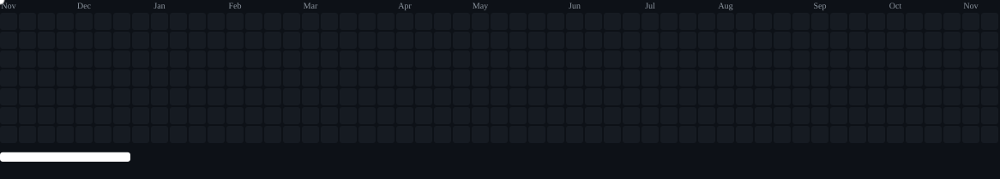

<!-- RIS theme: red #e01b31 on #14171b. Images in assets/ are redrawn daily by .github/workflows/arcade.yml -->

  

  
  
  

<table align="center">
  <tr>
    <td align="center" width="33%"><a href="https://networkfixit.com/products/macropod"><b>MACROPOD</b></a> Macros and remapping for Windows</td>
    <td align="center" width="33%"><a href="https://rubicon.networkfixit.com"><b>RUBICON</b></a> NxN Rubik's cube trainer in 3D</td>
    <td align="center" width="33%"><b>GAME MODS</b> Stationeers, Minecraft and more</td>
  </tr>
  <tr>
    <td align="center"><b>HOME LAB</b> Containers, monitoring, SSO, VPN</td>
    <td align="center"><b>DESKTOP APPS</b> Tauri, Electron, Rust</td>
    <td align="center"><b>WEB</b> React sites and small backends</td>
  </tr>
</table>

  

<b>Full tech stack and tools</b> (click to expand)

 

   
   
   
  

  
  
  
  
  
  
  
  
  
  
  
  
  
  
  
  
  
  
  
  
  
  
  
  
  
  
  
  

