<!-- Animated wave header -->

<!-- Typing animation -->

  

<!-- Badges -->

  
  
  
  

- **Macropod**: macros and remapping for Windows
- **Rubicon**: NxN Rubik's cube trainer in 3D
- **Game mods**: Stationeers, Minecraft and more
- **Home lab**: containers, monitoring, SSO, VPN

  

<b>Full tech stack and tools</b> (click to expand)

 

   
   
   
  

  
  
  
  
  
  
  
  
  
  
  
  
  
  
  
  
  
  
  
  
  
  
  
  
  
  
  
  

<!-- Contribution graph (green squares, in orange) and contribution trend -->

  

  

  

<!-- Cards built daily by this repo's own workflow (no outside service to go down) -->

  
  

  
  
  

<!-- Breakout: the ball smashes the contribution squares -->

  

<!-- Pac-Man eating the contribution grid -->

  

<!-- Snake eating the contribution grid -->

  

